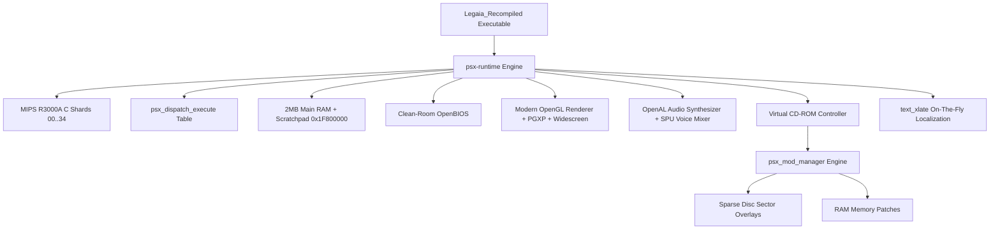

# 🏗️ Architecture & Engine Internals: LegaiaRecomp

## 1. Executive Summary
**LegaiaRecomp** is a native, statically recompiled port of *Legend of Legaia* (PlayStation 1, NTSC-U release `SCUS-94254`). Rather than running an emulator that interprets MIPS machine code or translates it dynamically via JIT, all original MIPS R3000A instructions and overlay modules were translated ahead-of-time (AOT) into clean, portable 64-bit C code.

The project is built on the [RetroPortingToolKit/psxrecomp](https://github.com/RetroPortingToolKit/psxrecomp) framework and runtime ecosystem, with modern SDL3 windowing, OpenGL 3.3+ rendering (with PGXP sub-pixel precision and true widescreen), OpenBIOS clean-room LLE BIOS, and an extensible native modding pipeline.

---

## 2. Recompilation Pipeline & Source Sharding

### Executable Binary Target
* **Disc Serial:** `SCUS-94254` (Legend of Legaia USA)
* **Executable Name:** `SCUS_942.54`
* **RAM Load Base:** `0x80010000`
* **Entry Point:** `0x80026C28`
* **Direct JAL Seeds Identified:** 654 entry points
* **Total Recompiled Functions:** 1,545 functions
* **Total Generated Native C Code:** ~1,263,897 lines of C

### Sharding Architecture (`generated/`)
To keep build times manageable and avoid compiler memory exhaustion on Windows MSVC and GCC/Clang, the translated code is split into 35 balance-sharded C files:
* `generated/SCUS_942.54_full_00.c` through `SCUS_942.54_full_34.c`: Individual function bodies translated into deterministic C statements.
* `generated/SCUS_942.54_dispatch.c`: Indirect jump dispatch tables and address resolution (`psx_dispatch_execute`, `psx_jump_indirect`).
* `generated/SCUS_942.54_decls.h`: Unified C headers declaring all 1,545 recompiled function prototypes.

> [!IMPORTANT]
> The files in `generated/` are committed to git so that end-users, CI builders, and contributors do NOT need Python or recompilation tools installed to compile the game. They only need a standard C/C++ compiler and CMake.

---

## 3. Subsystem Architecture

### 3.1 Memory Model
* **Main RAM:** 2,097,152 bytes (2 MB) mapped contiguously with bounds checking and memory guards.
* **Scratchpad:** 1,024 bytes (1 KB D-Cache) located at `0x1F800000`. Used heavily by Legaia's combat engine for real-time vertex calculations, animation frame interpolation, and matrix transformations.
* **MMIO Registers:** Mapped from `0x1F801000` to `0x1F802FFF` (DMA, Timers, Interrupt Controller, GPU, SPU, CD-ROM).

### 3.2 Geometry Transformation Engine (GTE)
Legaia's combat and 3D map rendering relies extensively on the PS1 GTE coprocessor (Coprocessor 2). GTE instructions (`RTPT`, `MVMVA`, `NCLIP`, `AVSZ3`, etc.) are translated into native 64-bit vector math in C, ensuring bit-exact perspective transformations while enabling PGXP sub-pixel floating-point vertex rendering to eliminate PS1 polygon jitter.

### 3.3 CD-ROM & Sparse Overlay Layer
The original game loads combat scenes, enemy models, cinematic spells, and field maps dynamically via CD-ROM sector reads.
* When a disc read command (`CdrRead`) occurs, `psx-runtime` checks active mods registered with `psx_mod_manager`.
* If a sector falls within a registered mod's sparse sector run (`[[runs]]`), the data is served directly from the mod's replacement asset buffer.
* Non-modified sectors are read transparently from the user's legal disc image (`disc/Legend of Legaia (USA).cue`).

### 3.4 Mod Engine (`.psxmod`)
* Mods are stored in `mods/packages/<package_id>/<version>/` or `mods/preloaded/packages/`.
* Each mod contains a `manifest.toml` adhering to Format Version 7.
* At runtime startup, `psx_mod_manager` parses `mods/state.toml` and applies:
  1. **Memory Patches:** Direct byte patches to recompiled executable memory or static arrays.
  2. **Disc Overlays:** Sparse CD-ROM sector interception runs.
  3. **Code Hooks:** Dynamic C function hooks for gameplay overrides.

### 3.5 On-The-Fly Localization (`text_xlate`)
* Enabled via `game.toml` under `[localization]`.
* Maps 64-bit FNV-1a hashes of original English strings to localized strings (`translations/legaia_id.toml`).
* Intercepts text draw routines non-destructively, allocating localized strings in dynamic scratchpad memory to bypass original PS1 8-bit string buffer length restrictions.

---

## 4. Build Targets & Artifacts

| Platform | Target Executable | Output Directory | Build Toolchain |
| :--- | :--- | :--- | :--- |
| **Linux (x86_64)** | `Legaia_Recompiled` | `build-release/` | GCC 11+ or Clang 14+, CMake, Ninja |
| **Windows (x64)** | `Legaia_Recompiled.exe` | `build-release/` | MSVC (Visual Studio 2022) or MinGW-w64 |
| **macOS (Apple Silicon/Intel)** | `Legaia_Recompiled` | `build-release/` | Clang, CMake, Ninja |
